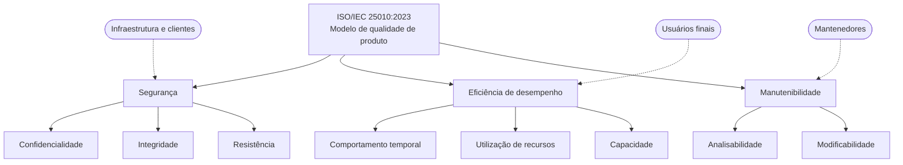

# Modelo de qualidade

## Base e adaptação

A base é o **modelo de qualidade de produto da ISO/IEC 25010:2023**, que organiza a qualidade em nove características. A equipe seleciona três delas para o [propósito de adoção](proposito.md): **Segurança, Eficiência de desempenho e Manutenibilidade**. O recorte e as prioridades são decisões do projeto, sem representar uma classificação completa do produto. A única referência normativa adotada nesta adaptação é a [ISO/IEC 25010:2023](https://www.iso.org/standard/78176.html).

O diagrama mostra as características, suas subcaracterísticas selecionadas e as partes interessadas que motivam a seleção. Ele representa o modelo da Fase 1; os objetivos, as questões e as métricas serão detalhados na Fase 2.

_Figura 1. Modelo de qualidade adaptado ao fluxo abrir–editar rótulos–exportar. Linhas contínuas indicam a decomposição do modelo; linhas tracejadas indicam as partes interessadas que motivam a seleção. Fonte: elaboração da equipe, com base na ISO/IEC 25010:2023._

## Subcaracterísticas selecionadas

| Característica           | Subcaracterística      | Aplicação no escopo                                                                                                                                                     |
| ------------------------ | ---------------------- | ----------------------------------------------------------------------------------------------------------------------------------------------------------------------- |
| Segurança                | Confidencialidade      | Examinar a proteção das informações dos diagramas durante a abertura e a exportação.                                                                                    |
| Segurança                | Integridade            | Examinar a proteção contra alterações indevidas nos fluxos de arquivos e rótulos.                                                                                       |
| Segurança                | Resistência            | Examinar se a proteção dos rótulos bloqueia variações dos ataques conhecidos durante a abertura de diagramas, no recorte de Q1.5 e M1.3. |
| Eficiência de desempenho | Comportamento temporal | Avaliar o tempo para abrir, atualizar o texto de um rótulo e exportar em cada formato.                                                                                  |
| Eficiência de desempenho | Utilização de recursos | Avaliar a memória JavaScript do editor nas operações selecionadas, sem equipará-la à memória total do ambiente.                                                         |
| Eficiência de desempenho | Capacidade             | Identificar o maior porte aprovado entre as cargas de 50, 300, 1.000, 2.000 e 5.000 formas, considerando o fluxo completo e os critérios que serão definidos na Fase 2. |
| Manutenibilidade         | Analisabilidade        | Examinar a facilidade de compreender o código de importação e edição de rótulos, apoiando a identificação de pontos de alteração.                                       |
| Manutenibilidade         | Modificabilidade       | Examinar aspectos do código de exportação que influenciam o esforço e os impactos de mudanças.                                                                          |

Para Eficiência, mantêm-se as três subcaracterísticas porque rapidez, consumo de recursos e porte suportado respondem a necessidades distintas dos [usuários finais](partes-interessadas.md#necessidades-de-eficiencia). A observação de recursos é parcial: o projeto delimita a coleta à memória JavaScript, sem cobrir todos os recursos computacionais.

Para Segurança, selecionam-se **confidencialidade, integridade e resistência**. A resistência foi incorporada ao modelo de Segurança na edição de 2023 da ISO/IEC 25010. Neste projeto, seu recorte é a proteção dos rótulos contra variações dos ataques conhecidos: a questão **Q1.5** e a hipótese **H1.5**, em [Objetivos, questões e hipóteses](../fase-2/objetivos-questoes-hipoteses.md), são verificadas pela **M1.3 — Taxa de bloqueio de variações dos ataques conhecidos**, descrita em [Métricas](../fase-2/metricas.md). Essa medida oferece uma observação parcial da resistência, limitada às variações e às condições definidas para os testes; não representa uma avaliação completa da subcaracterística.

Para Manutenibilidade, selecionam-se **analisabilidade e modificabilidade**, aplicadas ao código dos componentes escolhidos. As demais subcaracterísticas de Segurança e Manutenibilidade não receberão julgamento próprio neste recorte.

## Priorização

A **nota de ênfase, de 1 a 5**, expressa a prioridade relativa da característica para o esforço de avaliação: quanto maior a nota, maior a atenção proposta. Não é uma nota de qualidade do draw.io, uma probabilidade de falha nem um limiar de aprovação. Os valores deverão ser validados para o cenário do requisitante.

| Característica               | Ênfase  | Justificativa para a decisão do requisitante                                                                                                                                                                                                                        |
| ---------------------------- | ------- | ------------------------------------------------------------------------------------------------------------------------------------------------------------------------------------------------------------------------------------------------------------------- |
| **Segurança**                | **5/5** | O cenário envolve arquivos de clientes e hospedagem própria; a proteção da confidencialidade e da integridade condiciona a adoção.                                                                         |
| **Eficiência de desempenho** | **4/5** | Atrasos e consumo excessivo de memória podem interromper as três operações centrais, sobretudo em diagramas maiores. Tem prioridade alta; limites de porte podem ser considerados como ressalva de adoção, mantendo Segurança como prioridade máxima neste cenário. |
| **Manutenibilidade**         | **4/5** | Compreender e alterar os três componentes importa para corrigir e adaptar uma instalação própria. O recorte não cobre a manutenção de todo o produto.                                                                    |

As justificativas detalhadas estão em [características e priorização](caracteristicas.md).

## Características não selecionadas e compromissos

A edição de 2023 utiliza **capacidade de interação** e **flexibilidade**, em substituição às denominações usabilidade e portabilidade da edição anterior, e inclui **Safety**. O projeto mantém a terminologia da edição de 2023; abaixo, _Safety_ designa a proteção contra danos a pessoas, patrimônio ou ambiente, distinguindo-a de _Security_ (Segurança).

| Característica não selecionada | Motivo do recorte e consequência                                                                                                                                                                                                                 |
| ------------------------------ | ------------------------------------------------------------------------------------------------------------------------------------------------------------------------------------------------------------------------------------------------ |
| Adequação funcional            | O estudo fixa três operações e concentra o julgamento nas características escolhidas. Não avalia a completude ou a correção de todas as funções; conferir o funcionamento dos arquivos durante os ensaios não cobre essa característica inteira. |
| Compatibilidade                | Integrações, coexistência e intercâmbio amplo com outros sistemas estão fora do ambiente escolhido. A abertura e a exportação dos arquivos selecionados não demonstram interoperabilidade geral.                                                 |
| Capacidade de interação        | Não estão previstas sessões com usuários nem avaliação sistemática da interação. O tempo de resposta observado não permite concluir sobre facilidade de aprendizagem, operação ou acessibilidade.                                                |
| Confiabilidade                 | Não haverá estudo próprio de disponibilidade, tolerância a falhas e recuperação. Registrar falhas nos ensaios não permite generalizar a confiabilidade do serviço.                                                                               |
| Flexibilidade                  | Não serão comparadas plataformas, configurações ou estratégias de adaptação e escalabilidade da implantação. Variar o porte dos diagramas atende ao recorte de capacidade, sem cobrir a flexibilidade do produto.                                |
| Safety                         | O cenário não inclui operação crítica com análise específica de danos a pessoas, patrimônio ou ambiente. Esses riscos não receberão avaliação própria.                                                                                           |

O compromisso é concentrar o esforço nas decisões de adoção priorizadas, aceitando que as dimensões excluídas permaneçam sem julgamento. Isso não pressupõe que elas sejam atendidas por o draw.io ser um produto já existente.
