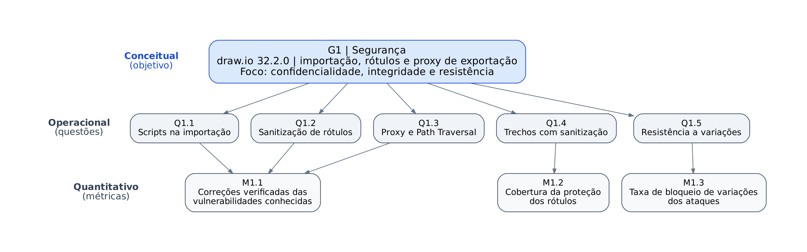
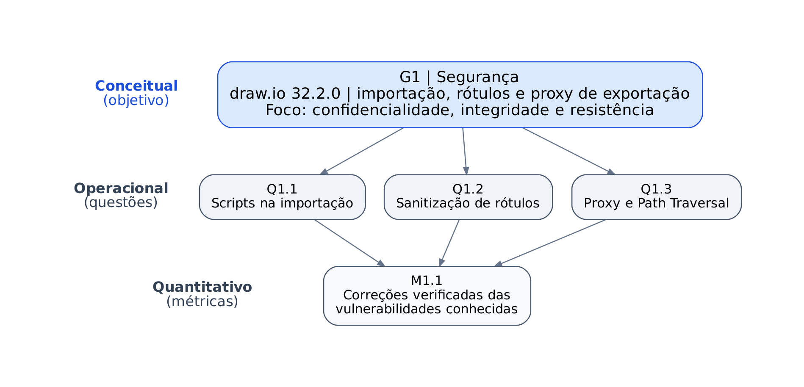
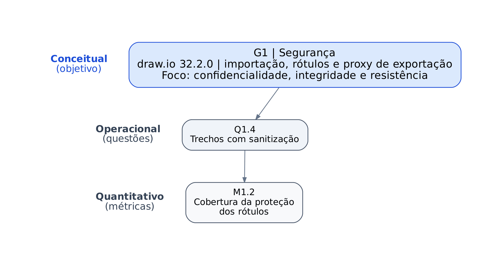
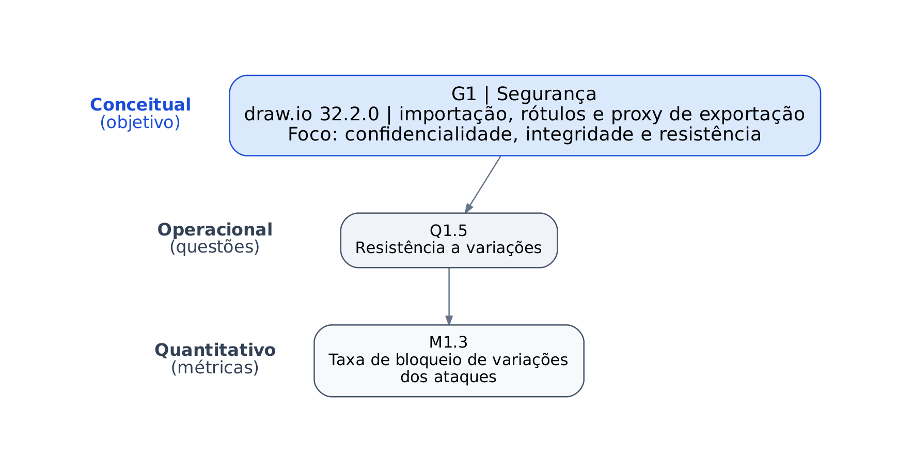
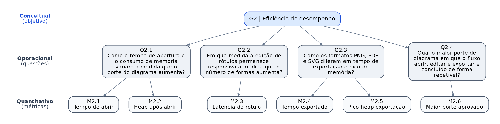
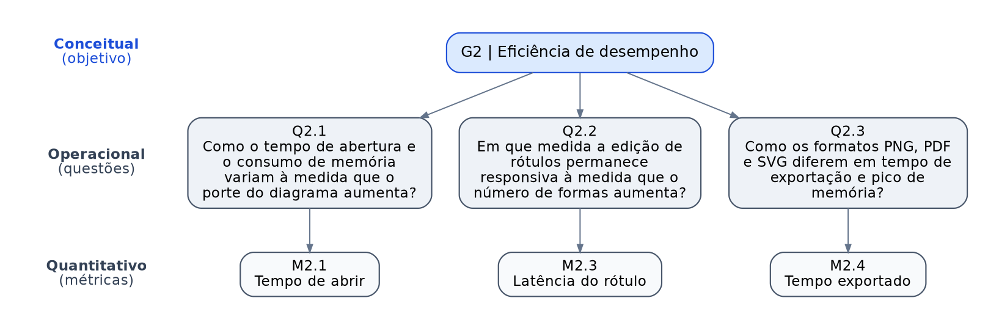
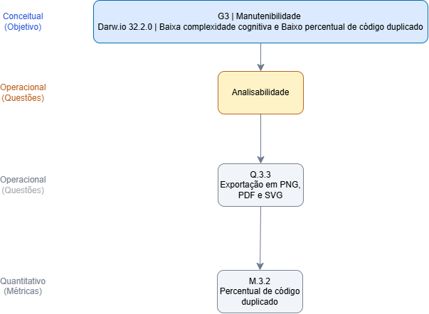
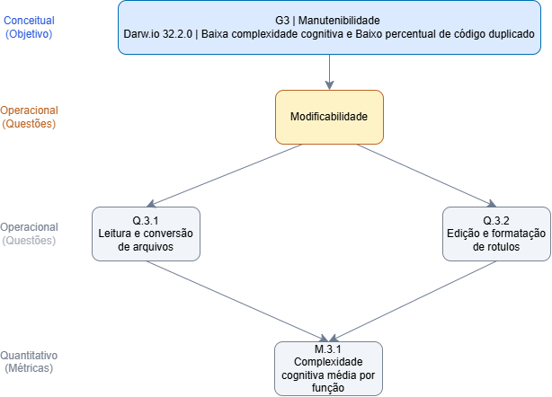

## Segurança

O objetivo G1 se desdobra em cinco questões (Q1.1 a Q1.5), cobrindo a verificação de vulnerabilidades conhecidas, a cobertura de sanitização e a resistência a variações de ataques, e cada questão é respondida por uma das três métricas (M1.1 a M1.3).

*Figura: hierarquia GQM da segurança. O objetivo G1 (nível conceitual) liga-se às questões Q1.1 a Q1.5 (nível operacional), e cada questão às suas métricas (nível quantitativo): Q1.1, Q1.2 e Q1.3 a M1.1; Q1.4 a M1.2; e Q1.5 a M1.3. Fonte: elaboração da equipe.*

### Recorte por subcaracterística

Os diagramas abaixo mostram, para cada foco da segurança (confidencialidade, integridade e resistência), quais questões e métricas a avaliam.

#### Confidencialidade e integridade (Vulnerabilidades conhecidas)

*Figura: vulnerabilidades conhecidas e verificadas, avaliadas pelo bloqueio de scripts na importação (Q1.1), pela sanitização de rótulos (Q1.2) e pelo controle de acesso a caminhos no proxy (Q1.3) através da métrica de correções verificadas (M1.1). Fonte: elaboração da equipe.*

#### Integridade (Cobertura da sanitização)

*Figura: integridade e sanitização dos rótulos, avaliada pela verificação dos trechos com sanitização (Q1.4) através da métrica de cobertura da proteção dos rótulos (M1.2). Fonte: elaboração da equipe.*

#### Resistência (Variações de ataques)

*Figura: resistência contra ataques, avaliada pela resistência a variações dos ataques conhecidos (Q1.5) através da taxa de bloqueio de variações dos ataques (M1.3). Fonte: elaboração da equipe.*

As definições estão em [Objetivos, questões e hipóteses](objetivos-questoes-hipoteses.md) e em [Métricas](metricas.md).

## Eficiência de desempenho

O objetivo G2 se desdobra em quatro questões, uma para cada operação do fluxo avaliado e uma para a capacidade, e cada questão é respondida por uma ou duas métricas.

*Figura: hierarquia GQM da eficiência de desempenho. O objetivo G2 (nível conceitual) se liga às questões Q2.1 a Q2.4 (nível operacional), e cada questão às suas métricas (nível quantitativo): Q2.1 a M2.1 e M2.2, Q2.2 a M2.3, Q2.3 a M2.4 e M2.5, e Q2.4 a M2.6. Fonte: elaboração da equipe.*
### Recorte por subcaracterística

Os diagramas abaixo mostram, para cada subcaracterística da eficiência de desempenho, quais questões e métricas a avaliam. Q2.1 e Q2.3 aparecem em mais de um recorte porque medem tanto o tempo quanto a memória.

#### Comportamento temporal

*Figura: comportamento temporal, avaliado pelo tempo de abrir (M2.1), pela latência do rótulo (M2.3) e pelo tempo de exportação (M2.4). Fonte: elaboração da equipe.*

#### Utilização de recursos

*Figura: utilização de recursos, avaliada pelo heap após abrir (M2.2) e pelo pico de heap na exportação (M2.5). Fonte: elaboração da equipe.*

#### Capacidade

*Figura: capacidade, avaliada pelo maior porte aprovado (M2.6). Fonte: elaboração da equipe.*

As definições estão em [Objetivos, questões e hipóteses](objetivos-questoes-hipoteses.md) e em [Métricas](metricas.md).

## Manutenibilidade 

O objetivo G3 se desdobra em 3 questões (Q3.1 a Q3.3), cobrindo a verificação da complexidade cognitiva dos códigos e verificação de redundâncias e duplicação de codigos, cada questão é respondida por uma das duas métricas (M3.1 e M3.2).

.png)

*Figura: hierarquia GQM da manutenibilidade. O objetivo G3 (nível conceitual) liga-se às questões Q3.1 a Q3.3 (nível operacional), e cada questão às suas métricas (nível quantitativo): Q3.1 e Q3.2. Fonte: elaboração da equipe.*

### Recorte por subcaracterística

Os diagramas abaixo mostram, para cada foco da segurança (Analisabilidade e modificabilidade), quais questões e métricas a avaliam.

#### Analisabilidade

*Figura: Analisabilidade, Analise da duplicação de código nas funções de exportação de imagens(Q 3.3) através da métrica de porcentagem de duplicação (M3.2). Fonte: elaboração da equipe.*

#### Modificabilidade

*Figura: Análise de complexidade, avaliada nos trechos de conversão de arquivos (Q3.1) e edição e formatação de rotulos (Q3.2) através da métrica  (M3.1). Fonte: elaboração da equipe.*

