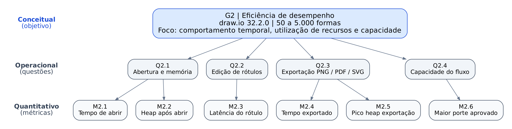
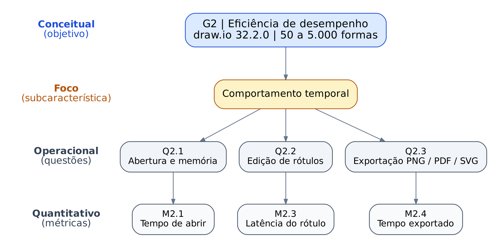
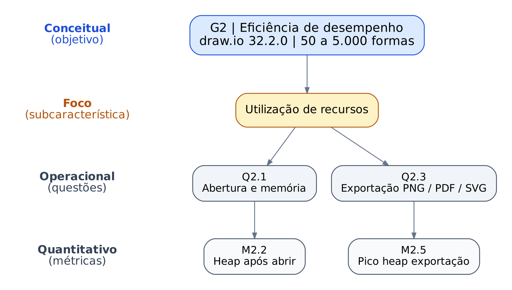
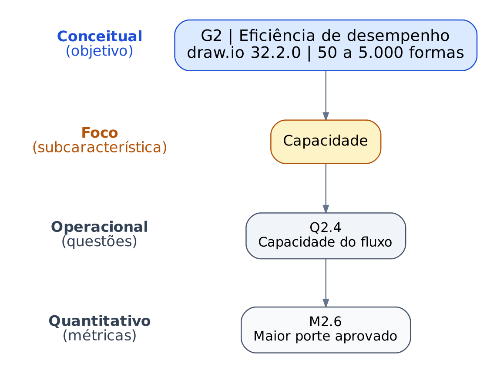

## Eficiência de desempenho

O objetivo G2 se desdobra em quatro questões, uma para cada operação do fluxo avaliado e uma para a capacidade, e cada questão é respondida por uma ou duas métricas.

*Figura: hierarquia GQM da eficiência de desempenho. O objetivo G2 (nível conceitual) se liga às questões Q2.1 a Q2.4 (nível operacional), e cada questão às suas métricas (nível quantitativo): Q2.1 a M2.1 e M2.2, Q2.2 a M2.3, Q2.3 a M2.4 e M2.5, e Q2.4 a M2.6. Fonte: elaboração da equipe; código-fonte Graphviz em [gqm-eficiencia.dot](../imagens/gqm-eficiencia.dot).*

### Recorte por subcaracterística

Os diagramas abaixo mostram, para cada subcaracterística da eficiência de desempenho, quais questões e métricas a avaliam. Q2.1 e Q2.3 aparecem em mais de um recorte porque medem tanto o tempo quanto a memória.

#### Comportamento temporal

*Figura: comportamento temporal, avaliado pelo tempo de abrir (M2.1), pela latência do rótulo (M2.3) e pelo tempo de exportação (M2.4). Fonte: elaboração da equipe.*

#### Utilização de recursos

*Figura: utilização de recursos, avaliada pelo heap após abrir (M2.2) e pelo pico de heap na exportação (M2.5). Fonte: elaboração da equipe.*

#### Capacidade

*Figura: capacidade, avaliada pelo maior porte aprovado (M2.6). Fonte: elaboração da equipe.*

As definições estão em [Objetivos, questões e hipóteses](objetivos-questoes-hipoteses.md) e em [Métricas](metricas.md).