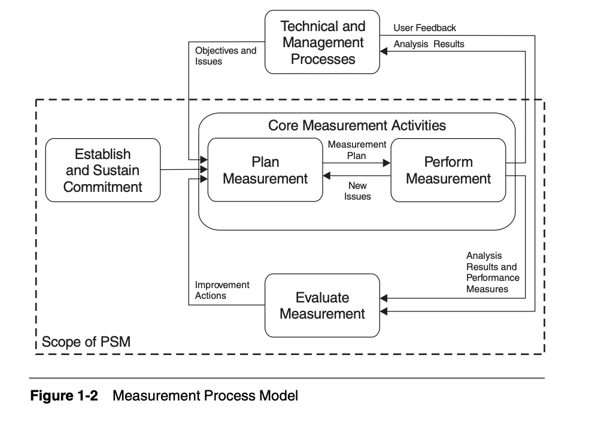

# Gestão do projeto

A equipe acompanha o projeto com o PSM (*Practical Software and Systems Measurement*), usando o guia para desenvolvimento contínuo e iterativo (PSM/CID). A especificação do trabalho (Seção 2) pede medidas em três categorias de informação, e a equipe escolheu uma medida para cada uma:

| Categoria de informação | Medida | Origem no PSM/CID | Pergunta que responde |
|---|---|---|---|
| Calendário e Progresso | Planejado vs. concluído (*Committed vs. Completed*) | Parte 1, Tabela 5, linha 1; Parte 2, seção 8.3 | As tarefas da sprint estão sendo entregues? |
| Recursos e Custos | Estimado vs. realizado (*Estimate vs. Actual Effort*) | Parte 1, Tabela 5, linhas 8 e 9 | As estimativas de esforço são precisas? |
| Desempenho dos Processos | Tempo de ciclo (*Cycle Time*) | Parte 1, Tabela 5, linhas 30 e 32; Parte 2, seção 8.5 | Quanto tempo uma tarefa leva, e o trabalho está andando? |

A descrição completa de cada medida, com as figuras da Tabela 5, está no [Plano de medição](plano-de-medicao.md).

As páginas de gestão seguem as atividades centrais do modelo de processo de medição do PSM (Figura 1): **planejar** a medição, **executar** a medição e **avaliar** os resultados para decidir as ações de melhoria.

{ width="560" }

_Figura 1. Modelo de processo de medição do PSM. Fonte: McGarry et al. (2002, cap. 1, Figura 1-2, p. 11)._

Planejar

<a class="mj-item" href="planejamento/"><small>Tarefas, responsáveis e estimativas (linha de base)</small>Planejamento das sprints</a>
<a class="mj-item" href="plano-de-medicao/"><small>Instância do modelo de informação de cada medida</small>Plano de medição</a>

Medir

<a class="mj-item" href="painel-psm/"><small>Atualizado automaticamente a partir das issues</small>Painel do PSM</a>
<a class="mj-item" href="horas/"><small>Horas e custo por integrante</small>Horas e custos</a>

Avaliar e decidir

<a class="mj-item" href="registro-de-medicoes/"><small>Valor, interpretação e decisão de cada medição</small>Registro de medições</a>
<a class="mj-item" href="atas/"><small>Reuniões e decisões da equipe</small>Atas de reunião</a>

Tarefas e sprints no GitHub: [milestones](https://github.com/FCTE-Qualidade-de-Software-1/2026-2_T01_MARY_JACKSON/milestones) e [issues](https://github.com/FCTE-Qualidade-de-Software-1/2026-2_T01_MARY_JACKSON/issues).