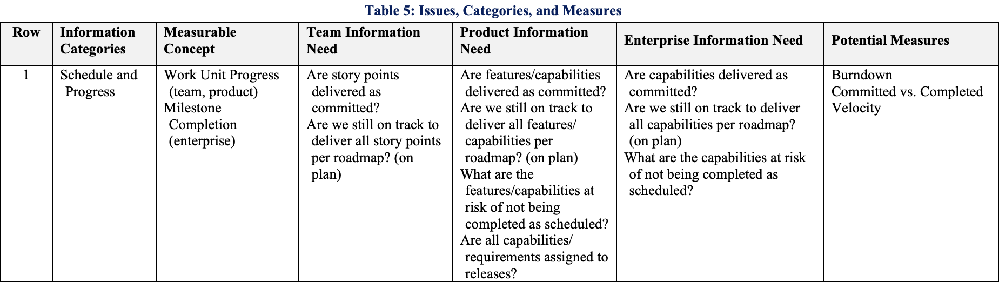
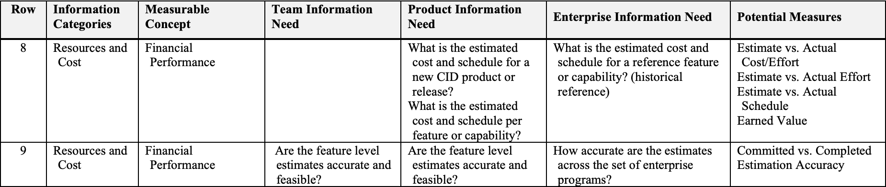
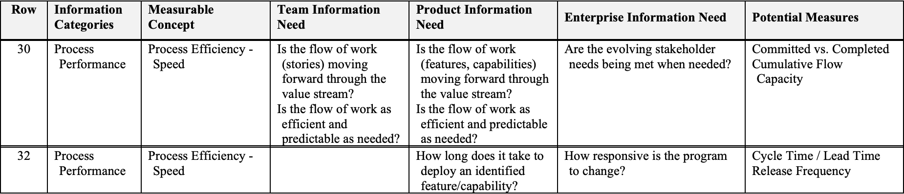
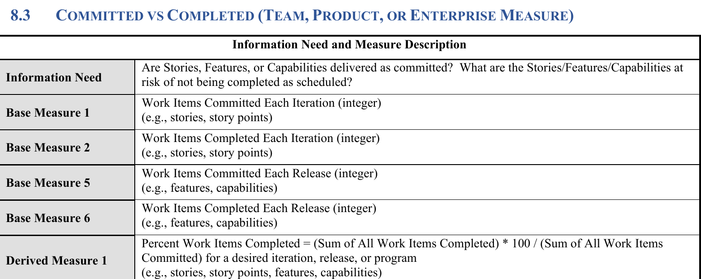
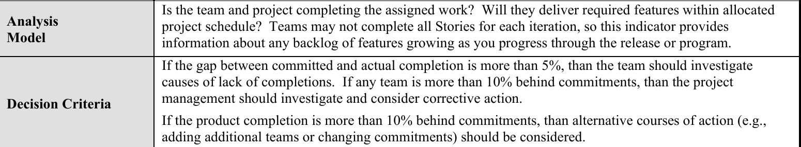
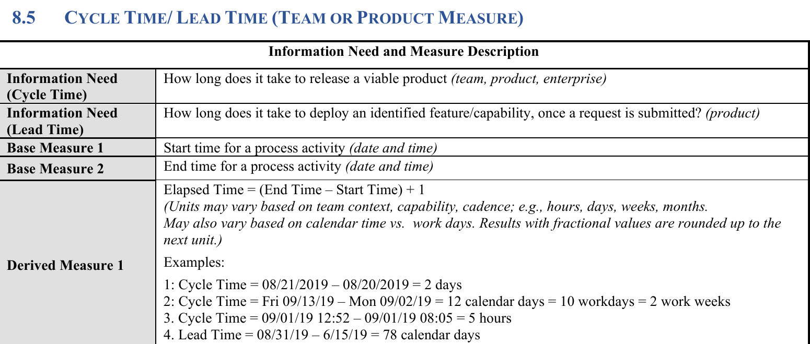
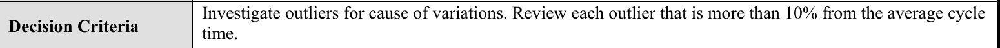

# Plano de medição

A gestão do projeto segue o PSM (*Practical Software and Systems Measurement*): cada medida responde a uma **necessidade de informação** da equipe e apoia uma **decisão** (Aula 09). A especificação do trabalho (Seção 2) pede medidas em três **categorias de informação**; a equipe escolheu uma medida para cada uma, na tabela de categorias, conceitos mensuráveis e medidas (ICM) do PSM/CID, e descreveu cada medida no template de instância do modelo de informação da Aula 09 (Figura 1).

Os valores medidos ficam no [Painel do PSM](painel-psm.md); a interpretação e as decisões de cada medição, no [Registro de medições](registro-de-medicoes.md). As referências completas estão em [Referências](../sobre/referencias.md).

{ width="620" }

_Figura 1. Template para descrever uma instância do modelo de informação (measurement construct). Fonte: Aula 09, slide 19._

## Origem das medidas

Cada medida foi tirada da Tabela 5 do PSM/CID (Parte 1). De cada linha usada vieram a categoria de informação, o conceito mensurável, as necessidades de informação e a medida, indicados na legenda de cada figura.

_Figura 2. Origem de **Planejado vs. concluído** (*Committed vs. Completed*): Tabela 5, linha 1. Fonte: PSM/CID Parte 1 (2021), p. 19._

_Figura 3. Origem de **Estimado vs. realizado** (*Estimate vs. Actual Effort*): Tabela 5, linha 8; a necessidade de informação da equipe vem da linha 9. Fonte: PSM/CID Parte 1 (2021), p. 20._

_Figura 4. Origem de **Tempo de ciclo** (*Cycle Time*): Tabela 5, linha 32; a necessidade de informação da equipe vem da linha 30. Fonte: PSM/CID Parte 1 (2021), p. 24._

As medidas foram adaptadas ao projeto (issues no lugar de *story points*). Estimado vs. realizado não tem especificação na Parte 2; o cálculo foi definido pela equipe.

## 1. Planejado vs. concluído

_Figura 5. Medidas básicas e fórmula do Committed vs. Completed. Fonte: PSM/CID Parte 2 (2021), seção 8.3, p. 15._

_Figura 6. Modelo de análise e critérios de decisão do Committed vs. Completed. Fonte: PSM/CID Parte 2 (2021), seção 8.3, p. 17._

A especificação do guia está nas Figuras 5 e 6; a Tabela 1 mostra a adaptação ao projeto.

| Campo do template | Definição |
|---|---|
| Necessidade de informação | As tarefas planejadas para a sprint estão sendo entregues? Quais estão em risco de não ser concluídas no prazo? |
| Conceito mensurável | Progresso das unidades de trabalho |
| Entidades relevantes | Issues de cada sprint (milestone) |
| Atributos | Situação de cada issue: aberta ou fechada |
| Medidas básicas | 1. P = issues planejadas na sprint. 2. C = issues fechadas da sprint |
| Método de medição | 1 e 2. Contagem automática das issues de cada milestone pelo script `hooks/horas.py`, a cada publicação do site |
| Tipo de método de medição | 1 e 2. Objetivo |
| Escala | 1 e 2. Inteiros de zero ao infinito |
| Tipo de escala | 1 e 2. Razão |
| Unidade de medida | 1 e 2. Issue |
| Medida derivada | Percentual concluído da sprint |
| Função de medição | C × 100 ÷ P |
| Indicador | Tabela e gráfico de barras por sprint, com a linha do critério de decisão, no [Painel do PSM](painel-psm.md) |
| Modelo de análise | Quanto maior a diferença entre o planejado e o concluído, maior o risco de a sprint não cumprir o seu marco |
| Critérios de decisão | **Guia (Parte 2, p. 17), no fim da sprint:** diferença acima de 5%, investigar as causas; acima de 10%, tomar ação corretiva. **Equipe, na metade da sprint:** menos de 50% concluído, redistribuir as tarefas |

_Tabela 1. Instância do modelo de informação de Planejado vs. concluído. Fonte: elaboração da equipe, com base na Aula 09 e no PSM/CID._

## 2. Estimado vs. realizado

Como o guia não especifica esta medida, a Tabela 2 foi definida pela equipe a partir da linha 8 da Tabela 5 do PSM/CID (Figura 3).

| Campo do template | Definição |
|---|---|
| Necessidade de informação | As estimativas de esforço e de custo da equipe são precisas? |
| Conceito mensurável | Desempenho financeiro |
| Entidades relevantes | Tarefas (issues) de cada sprint |
| Atributos | Esforço estimado e esforço realizado |
| Medidas básicas | 1. E = horas estimadas da sprint. 2. R = horas realizadas da sprint |
| Método de medição | 1. Soma do campo "Estimativa (horas)" das issues. 2. Soma das horas registradas em `dados/gestao/horas.csv` e no campo "Horas reais" das issues, sem contar a mesma hora duas vezes (regras no [Painel do PSM](painel-psm.md#conferencia-das-horas)) |
| Tipo de método de medição | 1. Subjetivo (cada responsável estima as próprias tarefas). 2. Objetivo |
| Escala | 1 e 2. Reais de zero ao infinito |
| Tipo de escala | 1 e 2. Razão |
| Unidade de medida | 1 e 2. Hora |
| Medidas derivadas | Razão entre o realizado e o estimado; custo realizado |
| Função de medição | Razão = R ÷ E. Custo = R × R$ 14,77 por hora ([Horas e custos](horas.md)) |
| Indicador | Tabela e gráfico por sprint e conferência das horas por integrante no [Painel do PSM](painel-psm.md) |
| Modelo de análise | Razão acima de 1: a equipe subestimou o esforço; abaixo de 1: superestimou |
| Critério de decisão | **Equipe:** razão acima de 1,5, revisar as estimativas das tarefas restantes |

_Tabela 2. Instância do modelo de informação de Estimado vs. realizado. Fonte: elaboração da equipe, com base na Aula 09 e no PSM/CID._

## 3. Tempo de ciclo

_Figura 7. Medidas básicas e fórmula do Cycle Time. Fonte: PSM/CID Parte 2 (2021), seção 8.5, p. 24._

_Figura 8. Critério de decisão do Cycle Time. Fonte: PSM/CID Parte 2 (2021), seção 8.5, p. 26._

A especificação do guia está nas Figuras 7 e 8; a Tabela 3 mostra a adaptação ao projeto.

| Campo do template | Definição |
|---|---|
| Necessidade de informação | Quanto tempo uma tarefa leva para ser concluída, e o trabalho está andando ou parado? |
| Conceito mensurável | Eficiência do processo: velocidade |
| Entidades relevantes | Issues |
| Atributos | Data de abertura, data de fechamento e data da última atualização |
| Medidas básicas | 1. Data de início (abertura da issue). 2. Data de fim (fechamento da issue) |
| Método de medição | 1 e 2. Leitura automática das datas registradas pelo GitHub em cada issue, pelo script `hooks/horas.py` |
| Tipo de método de medição | 1 e 2. Objetivo |
| Escala | 1 e 2. Datas e horas do calendário |
| Tipo de escala | 1 e 2. Intervalar |
| Unidade de medida | 1 e 2. Data e hora |
| Medida derivada | Tempo de ciclo de cada issue; média e mediana por sprint |
| Função de medição | Data de fim − data de início, em dias com fração (as datas do GitHub incluem a hora; por isso não se soma 1 dia, como no exemplo 3 da Figura 7) |
| Indicador | Tabela e gráfico por sprint e lista de issues paradas no [Painel do PSM](painel-psm.md) |
| Modelo de análise | Tempos maiores indicam tarefas acumuladas ou paradas; tempos muito curtos podem indicar tarefas concluídas sem acompanhamento durante a sprint |
| Critérios de decisão | **Guia (Parte 2, p. 26):** investigar as issues fechadas com tempo de ciclo mais de 10% acima ou abaixo da média. **Equipe:** issue aberta há mais de 1 dia sem atualização, contado a partir do início da sprint, cobrar o responsável ou dividir a tarefa (limite revisto na Medição 2) |

_Tabela 3. Instância do modelo de informação de Tempo de ciclo. Fonte: elaboração da equipe, com base na Aula 09 e no PSM/CID._

Os critérios marcados como "Equipe" foram definidos pelo grupo para o prazo curto da E1; a Aula 09 admite critérios baseados em acordos, e eles podem ser revistos a cada medição.

## Calendário das medições

As medições seguem o calendário da Tabela 4.

| Medição | Data | Momento |
|---|---|---|
| 1 | 18/10/2026 | Fim da Sprint 1 |
| 2 | 22/10/2026 | Fim da Sprint 2 |
| Consulta | 24/10/2026 | Metade da Sprint 3 |
| 3 | 26/10/2026 | Entrega 1 |

_Tabela 4. Calendário das medições. Fonte: elaboração da equipe._