# Registro de medições

Cada medição segue o [Plano de medição](plano-de-medicao.md): valor, interpretação e a decisão tomada, que também fica registrada nas [Atas](atas.md).

## Medição 1 (Sprint 1: 14/10 a 19/10/2026), registrada retroativamente

**Linha de base:** as tarefas e estimativas da Sprint 1 no [Planejamento](planejamento.md) (versão 0.6, de 18/10). As issues foram criadas depois da execução das tarefas; por isso, a conclusão foi verificada pela data do commit no repositório (incluindo os commits do PR #13) ou, para o relatório, pelo histórico de versões do Overleaf. As horas vêm de [`dados/gestao/horas.csv`](horas.md).

### Calendário e Progresso: planejado vs. concluído

| Tarefa planejada | Responsável | Estimativa | Evidência | Data | Situação em 19/10 |
|---|---|---|---|---|---|
| Configuração do repositório e milestones | Yasmin | 2,5 h | Repositório: commit 2e53f14; milestones criadas em 20/10 | 16/10 e 20/10 | Parcial |
| Pesquisa e redação de ODS, metas e indicadores | a definir | 2 h | Commit d1e78d1 (Miquéias) | 20/10 | Atrasada |
| Justificativa da característica Segurança | Miquéias | 1 h | Overleaf: `secoes/seguranca.tex` criado por Miquéias; GitPage no commit 4454358 (20/10) | 18/10 | Concluída |
| Reunião de início e Ata 01 | Yasmin e Miquéias | 1 h | Reunião em 14/10; ata no commit c166fb5 | 14/10 e 20/10 | Parcial |
| Revisão da Fase 1 e Ata 02 | Yasmin | 0,5 h | Reunião em 18/10; ata no commit c166fb5 | 18/10 e 20/10 | Parcial |
| Propósito, requisitante, stakeholders e escopo | Pedro Ian | 3 h | Commit 6cd9d56 (PR #13) | 19/10 | Concluída |
| Integração e revisão da Fase 1 | Pedro Ian | 2 h | Commit 6cd9d56, coautoria (PR #13) | 19/10 | Concluída |
| Justificativa e priorização de Eficiência | Pedro Ian | 1 h | Commit 6cd9d56 (PR #13) | 19/10 | Concluída |
| Modelo de qualidade adaptado e matriz de priorização | Thiago | 3 h | Commit 6cd9d56 (PR #13) | 19/10 | Concluída |
| Justificativa de Eficiência e contribuição para a Fase 1 | Thiago | 1 h | Commit 6cd9d56 (PR #13) | 19/10 | Concluída |
| Script de geração de diagramas e teste no DevTools | Thiago | 3 h | Sem evidência no repositório nem no Overleaf [confirmar com Thiago] | — | Sem evidência |
| Descrição do draw.io e diagrama de contexto | Heyttor | 2,5 h | Commits a11a2be, 15f51fa e efadcc8 | 18 e 19/10 | Concluída |
| Template SBC do relatório | Lucas | 1 h | Overleaf: modelo SBC (`sbc-template.sty`, `sbc.bst`) carregado por Lucas; modelo ABNT anterior em 17/10 | 18/10 | Concluída |

**Resumo:** das 13 tarefas planejadas, 8 foram concluídas no prazo (61,5%), 3 ficaram parciais, 1 atrasou e 1 não tem evidência. Em horas estimadas, as tarefas concluídas no prazo somam 14,5 h das 23,5 h planejadas para a sprint (61,7%).

**Trabalho realizado fora da linha de base da Sprint 1** (evidências no Overleaf e no repositório):

| Trabalho | Quem | Data | Previsto para |
|---|---|---|---|
| Introdução do relatório (primeira versão) | Heyttor e Lucas | 17/10 | Sprint 3 |
| GQM de Manutenibilidade no relatório | Lucas | 17/10 e 19/10 | Sprint 2 |
| GQM, fichas e diagrama GQM de Eficiência no relatório | Thiago e Pedro Ian | 18 e 19/10 | Sprint 2 |
| Objetivo GQM de Segurança no relatório | Miquéias | 18 e 19/10 | Sprint 2 |
| Termo de consentimento | Heyttor | 19/10 (commit a695434) | não previsto |
| Nota e justificativa de Manutenibilidade | Lucas | 19/10 (commit eb18de7) | não previsto |
| Estudo das CVEs do draw.io | Yasmin | 18/10 | não previsto |
| Planejamento, estimativas e organização do repositório | Yasmin | 13 a 18/10 | parcialmente previsto |

### Recursos e Custos: estimado vs. realizado

| Dupla | Estimado na Sprint 1 | Registrado até 18/10 | Realizado / estimado |
|---|---|---|---|
| Dupla 1 (Yasmin e Miquéias) | 7 h | 8,17 h (Yasmin) | 116,7% |
| Dupla 2 (Pedro Ian e Thiago) | 13 h | 0 h | 0% |
| Dupla 3 (Heyttor e Lucas) | 3,5 h | 1,33 h (Heyttor) | 38,0% |
| **Total** | **23,5 h (R$ 347,09)** | **9,5 h (R$ 140,31)** | **40,4%** |

Custo calculado com R$ 14,77 por hora ([Registro de horas](horas.md)).

### Desempenho dos Processos: tempo de entrega

Data em que cada tarefa planejada ficou completa (12 tarefas com evidência):

| Data da conclusão | Tarefas |
|---|---|
| 18/10 | 2 (template SBC; justificativa de Segurança no relatório) |
| 19/10 | 6 (cinco tarefas da Fase 1 da Dupla 2; descrição do draw.io) |
| 20/10 | 4 (configuração com milestones, ODS, Atas 01 e 02) |

### Interpretação e decisões

| Indicador | Interpretação | Decisão |
|---|---|---|
| Planejado vs. concluído | A Fase 1 foi entregue no prazo, e parte da Fase 2 e da Introdução já começou no relatório durante a Sprint 1. O atraso ficou nas tarefas de registro: atas, milestones e ODS. A publicação na GitPage chegou depois do relatório. | Criar o GitHub Project, as milestones e uma issue por tarefa; registrar as atas logo após cada reunião; manter a regra de concluir no relatório e depois publicar na GitPage (Ata 03). |
| Estimado vs. realizado | Só dois dos seis membros registraram horas, embora o histórico do Overleaf mostre trabalho de todos. A diferença mostra falta de registro, e não esforço menor. A Dupla 1 passou da estimativa porque as tarefas de gestão não estavam na linha de base. | Cada membro registra as horas com o número da issue; commits de horas usam "Refs #9". As tarefas de gestão passam a constar no planejamento como trabalho não planejado. |
| Tempo de entrega | Todas as tarefas foram concluídas nos dois últimos dias da sprint (18 e 19/10) ou no dia seguinte. | Fazer um ponto de acompanhamento no meio de cada sprint. |

## Medição parcial (20/10/2026, meio da Sprint 2)

| Indicador | Valor | Interpretação | Decisão |
|---|---|---|---|
| Planejado vs. concluído | Issues fechadas: Sprint 1, 8 de 11 (72,7%); Sprint 2, 3 de 11 (27,3%); E1, 11 de 30 (36,7%). | A issue de registro de horas (#9) acompanha o projeto inteiro e foi associada à Sprint 1. A Sprint 2 está abaixo de 50% na metade do prazo. | Mover a #9 para a Sprint 3, fechar as issues já concluídas que ficaram abertas e redistribuir as tarefas da Sprint 2 (Ata 03). |
| Estimado vs. realizado | 12,0 h registradas de 70,5 h estimadas para a E1 (17,0%); R$ 177,24 de R$ 1.041,29. | Três dos seis membros ainda não registraram horas. | Cobrar o registro de todos até a Medição 2. |
| Tempo de ciclo | Não medido | As issues foram criadas depois da execução das tarefas. | Medir na Medição 2, com as tarefas abertas a partir de 20/10. |

## Medição 2 (fim da Sprint 2, 22/10/2026)

**Fonte:** [Painel do PSM](painel-psm.md) na última publicação do fim da Sprint 2, em 22/10/2026 às 22h07 (versão `51b6cff` da branch `gh-pages`, que guarda cada publicação do site). As figuras abaixo são recortes dessa publicação; o painel mostra 23/10, 01h07, porque o GitHub gera o site no horário UTC.

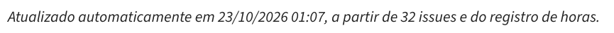{ width="520" }

_Figura 1. Topo do Painel do PSM na publicação usada nesta medição. O horário aparece em UTC: 23/10, 01h07, corresponde a 22/10, 22h07, em Brasília. Fonte: Painel do PSM, versão `51b6cff`._

**Mudança de método desde a Medição 1:** as três métricas passaram a ser calculadas automaticamente pelo painel. Até 22/10, as horas foram registradas em `dados/gestao/horas.csv` com o número da issue; a partir da Sprint 3, passam a ser registradas no campo "Horas reais" das issues (Ata 04). O painel soma as duas fontes sem contar a mesma hora duas vezes.

### Calendário e Progresso: planejado vs. concluído

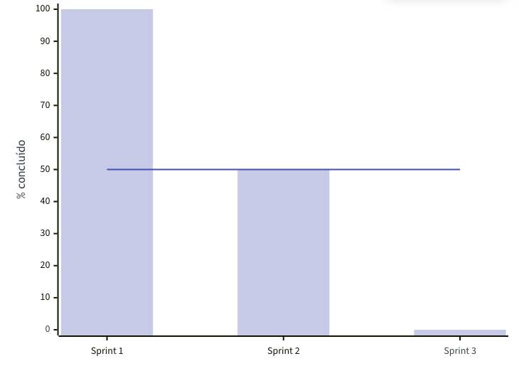{ width="420" }

_Figura 2. Planejado vs. concluído no fim da Sprint 2. Barras lilás: percentual de issues concluídas por sprint; linha azul: limite de decisão (50%). Fonte: Painel do PSM, versão `51b6cff`._

- **Valor:** Sprint 1, 10 de 10 tarefas concluídas (100%); Sprint 2, 6 de 12 (50%).
- **Interpretação:** a Sprint 1 fechou com todas as tarefas concluídas, e a Sprint 2, com metade. O GQM foi antecipado para o Ponto de Controle de 21/10, e o feedback da professora gerou correções que não couberam no prazo de 22/10. A #8 (estimativas) foi concluída em 18/10, mas fechada só em 22/10.
- **Decisão:** replanejar para a Sprint 3 as issues abertas da Sprint 2, incluindo as correções do GQM das três características (Ata 04); fechar a issue no próprio commit que conclui a tarefa (`Fixes #n`).

### Recursos e Custos: estimado vs. realizado

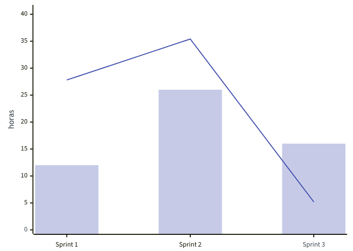{ width="420" }

_Figura 3. Estimado vs. realizado no fim da Sprint 2. Barras lilás: horas estimadas por sprint; linha azul: horas reais. Fonte: Painel do PSM, versão `51b6cff`._

- **Valor:** Sprint 1, 27,8 h de 12,0 h estimadas (razão 2,31); Sprint 2, 35,4 h de 26,0 h (razão 1,36). Total até 22/10: 68,4 h de 70,5 h estimadas para a E1 (97%), R$ 1.010,27. A conferência por integrante está no [Painel do PSM](painel-psm.md#conferencia-das-horas).
- **Interpretação:** a Sprint 1 passou do limite de 1,5 porque a gestão e o planejamento não tinham estimativa na linha de base, e porque as issues #3 e #6 não têm estimativa numérica. Com a Sprint 3 ainda por fazer, o total da E1 vai ultrapassar a estimativa. As horas estão concentradas: uma integrante tem 42% do total registrado.
- **Decisão:** incluir na estimativa da Sprint 3 as tarefas de gestão e de correção do feedback; cada responsável troca por um número a estimativa das issues #3, #6, #12, #19, #23 e #30.

### Desempenho dos Processos: tempo de ciclo

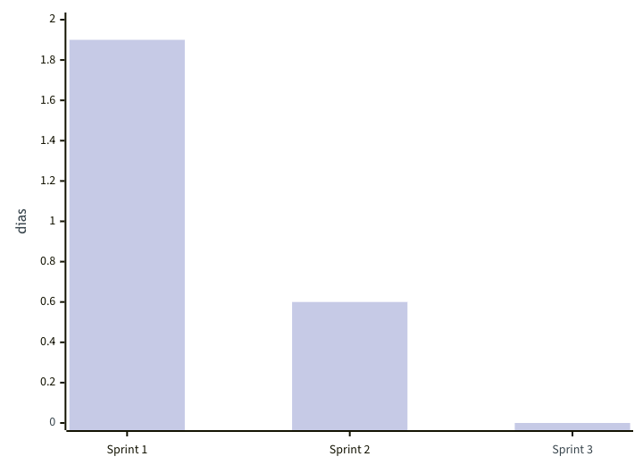{ width="420" }

_Figura 4. Tempo de ciclo no fim da Sprint 2. Barras lilás: média de dias entre abrir e fechar a issue, por sprint. Fonte: Painel do PSM, versão `51b6cff`._

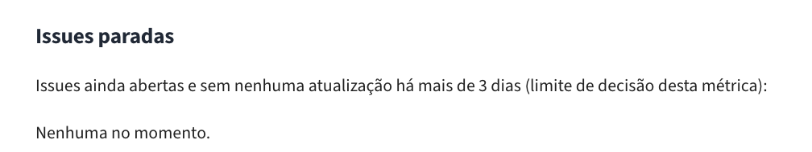{ width="520" }

_Figura 5. Issues paradas no fim da Sprint 2: nenhuma issue aberta estava sem atualização acima do limite de 3 dias vigente na época. Fonte: Painel do PSM, versão `51b6cff`._

- **Valor:** média de 1,9 dia na Sprint 1 (mediana 1,6) e de 0,6 dia na Sprint 2 (mediana 0,5); nenhuma issue parada.
- **Interpretação:** as tarefas da Sprint 2 foram abertas e fechadas no mesmo dia ou no seguinte, porque foram concentradas antes do Ponto de Controle. Na Sprint 1, o tempo inclui o fechamento atrasado da #8. Nenhuma issue estava parada no fim da sprint.
- **Decisão:** reduzir o limite de 3 dias para 1 dia sem atualização, contado a partir do início da sprint: na Sprint 3, de 4 dias (23 a 26/10), o limite de 3 dias só dispararia depois do fim da sprint, e as issues criadas antes da sprint apareciam como paradas no primeiro dia. Consultar o painel de novo em 24/10 (metade da Sprint 3) para decidir se é preciso redistribuir tarefas.

**Aprovação das decisões:** propostas pela gestão em 23/10/2026 e aprovadas pela equipe em enquete no grupo de WhatsApp, encerrada em 24/10/2026 às 12h: as quatro decisões foram aprovadas, sem votos contrários (5 integrantes votaram; os demais foram contados como de acordo, conforme a regra da enquete).

## Consulta da metade da Sprint 3 (24/10/2026)

**Fonte:** [Painel do PSM](painel-psm.md) publicado em 24/10/2026 às 14h16 (versão `1aba800` da branch `gh-pages`; o painel dessa versão mostra 17:16 porque ainda usava o horário UTC). Decisões e verificação de 25/10 registradas na [Ata 05](https://github.com/FCTE-Qualidade-de-Software-1/2026-2_T01_MARY_JACKSON/blob/main/atas/2026-10-25-ata-05.md).

| Medida | Valor | Interpretação | Decisão |
|---|---|---|---|
| Planejado vs. concluído | Sprint 3: 0 de 13 issues concluídas (0%) | Abaixo do limite da equipe (50% na metade da sprint). Parte das tarefas só pode ser concluída no fim da sprint (#29 e #31). | Redistribuir o trabalho da Dupla 1: o Miquéias assume o conteúdo (#33, #34 e #24) e a Yasmin, a revisão e a gestão. Orientar o grupo a fechar cada issue no dia em que concluir a tarefa. |
| Estimado vs. realizado | Sprint 3: 7,8 h de 20,0 h estimadas (razão 0,39) | Dentro do limite (1,5). O valor ainda é parcial: parte das horas não tinha sido registrada nas issues. | Todos registram as horas, inclusive as retroativas, até 25/10 às 20h. |
| Tempo de ciclo (issues paradas) | 11 issues sem atualização há mais de 1 dia: #9, #12, #21, #23, #24, #26, #27, #28, #29, #30, #31 | Acima do limite de 1 dia. Inclui issues de sprints anteriores ainda abertas (#9 e #12) e tarefas previstas para o fim da sprint (#29 e #31). | Cada responsável comenta na própria issue o que falta; a issue sem andamento até 25/10 às 12h é dividida com outra dupla. A proposta foi enviada ao grupo; o Pedro Ian concordou, e não houve manifestação contrária. |

## Medição 3 (fim da Sprint 3, 26/10/2026)

**Fonte:** [Painel do PSM](painel-psm.md) publicado em 26/10/2026 às 14h05 (versão `d69793d` da branch `gh-pages`). As figuras abaixo são recortes dessa publicação. O corte foi feito depois do prazo combinado para o registro de horas (25/10, 20h, Ata 05); as horas registradas até o corte estão incluídas. Os valores das medições anteriores continuam os registrados nas versões citadas em cada uma.

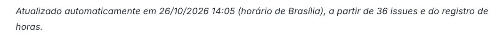{ width="620" }

_Figura 6. Topo do Painel do PSM na publicação usada nesta medição. Fonte: Painel do PSM, versão `d69793d`._

### Calendário e Progresso: planejado vs. concluído

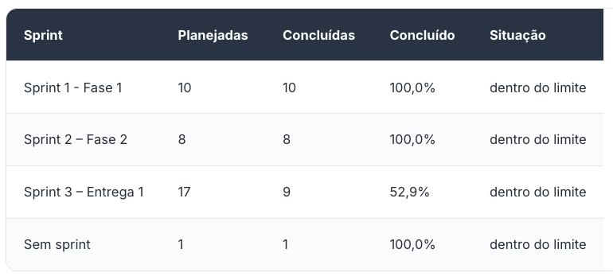{ width="520" }

_Figura 7. Issues planejadas e concluídas por sprint. Fonte: Painel do PSM, versão `d69793d`._

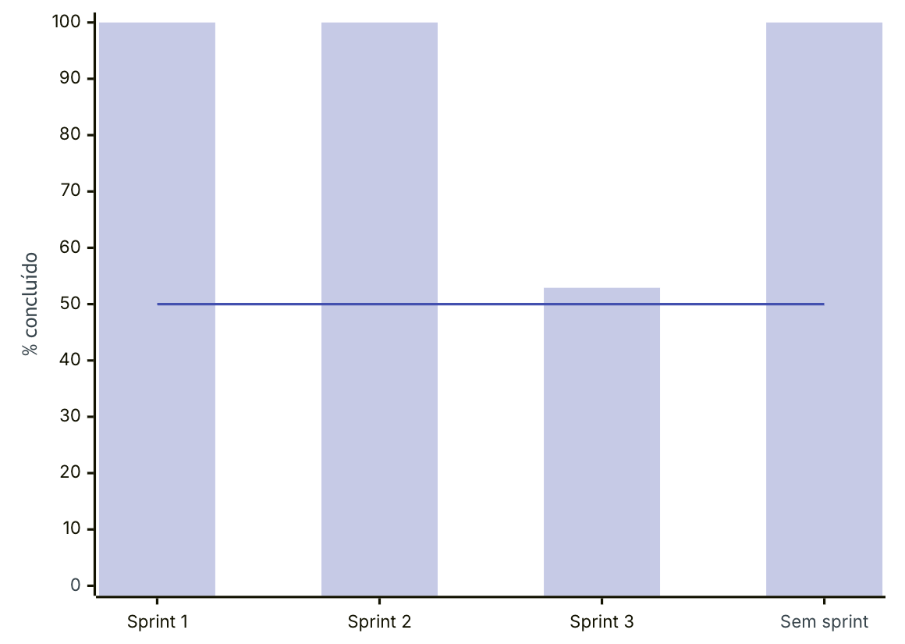{ width="420" }

_Figura 8. Percentual concluído por sprint. Barras lilás: percentual de issues concluídas; linha azul: limite de decisão (50%). Fonte: Painel do PSM, versão `d69793d`._

- **Interpretação:** a Sprint 3 ficou dentro do limite de decisão do painel, mas a diferença de 47,1% entre o planejado e o concluído passa do limite de 10% do guia (Parte 2, p. 17), o que pede ação corretiva. Parte das issues abertas só fecha com a entrega (Medição 3, tabela de contribuição, montagem do artigo e release). A Sprint 2 aparece completa porque as issues abertas foram movidas para a Sprint 3, conforme decidido na Medição 2.
- **Decisão:** replanejar para a E2 as issues não concluídas na E1, com comentário na issue. Na E2, planejar menos issues de revisão no fim de cada sprint e aplicar a regra de acompanhamento com prazo e responsável pela verificação (Ata 05).

### Recursos e Custos: estimado vs. realizado

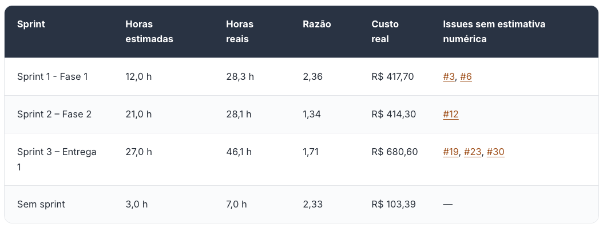{ width="620" }

_Figura 9. Horas estimadas e reais por sprint. Fonte: Painel do PSM, versão `d69793d`._

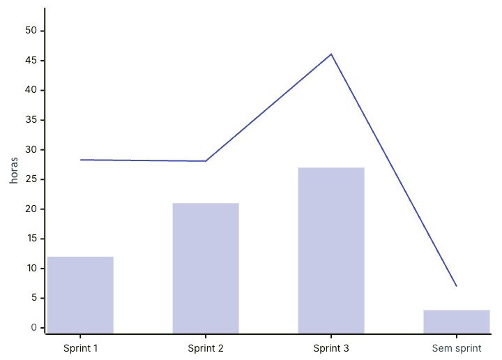{ width="420" }

_Figura 10. Estimado vs. realizado. Barras lilás: horas estimadas por sprint; linha azul: horas reais. Fonte: Painel do PSM, versão `d69793d`._

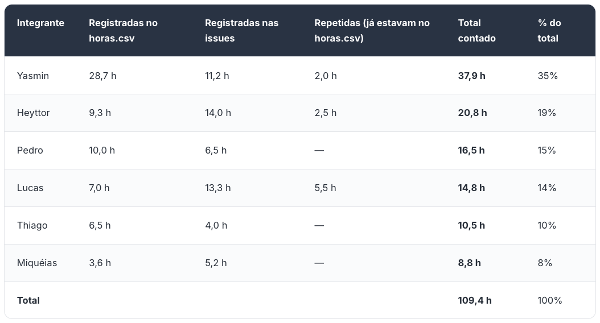{ width="620" }

_Figura 11. Horas por integrante na E1, base da tabela de contribuição do artigo. Fonte: Painel do PSM, versão `d69793d`._

- **Interpretação:** as Sprints 1 e 3 passam do limite de 1,5. As issues sem estimativa numérica entram com horas reais e sem estimativa, o que aumenta a razão. Além disso, a gestão, a revisão do artigo e as correções do feedback do Ponto de Controle 1 não foram estimadas. As horas das issues movidas da Sprint 2 passaram a contar na Sprint 3, o que também aumenta a razão dessa sprint.
- **Decisão:** na E2, toda issue deve ter estimativa numérica ao ser aberta; gestão, revisão cruzada e montagem do artigo passam a ser estimadas como tarefas próprias, e a razão da E1 é usada para calibrar as novas estimativas.

### Desempenho dos Processos: tempo de ciclo

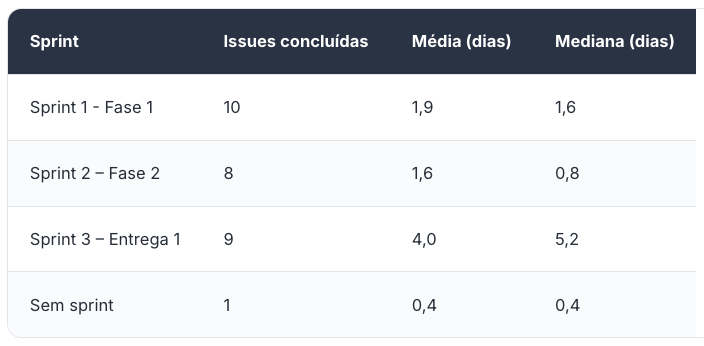{ width="480" }

_Figura 12. Média e mediana do tempo de ciclo por sprint. Fonte: Painel do PSM, versão `d69793d`._

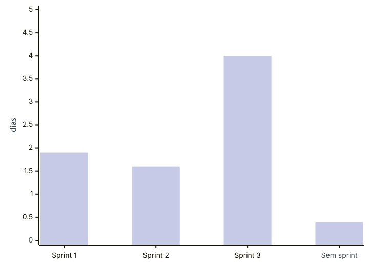{ width="420" }

_Figura 13. Tempo de ciclo médio por sprint. Barras lilás: média de dias entre abrir e fechar a issue. Fonte: Painel do PSM, versão `d69793d`._

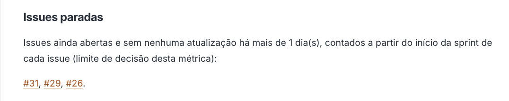{ width="620" }

_Figura 14. Issues paradas no fim da Sprint 3, pelo limite de 1 dia sem atualização. Fonte: Painel do PSM, versão `d69793d`._

- **Interpretação:** na Sprint 3, a mediana (5,2 dias) ficou acima da média, ou seja, mais da metade das issues levou mais de 5 dias para fechar. Como o painel não permite aplicar o critério do guia (ver limitação abaixo), foi analisada a causa geral: as issues movidas da Sprint 2 continuaram com a data de abertura de 20/10, e várias issues da Sprint 3 foram criadas antes do início da sprint e fechadas só no fim. As issues paradas são as últimas tarefas da entrega (montagem do artigo, Medição 3 e release).
- **Decisão:** na E2, abrir as issues no início de cada sprint e fechá-las assim que a tarefa terminar. Incluir no painel o tempo de ciclo de cada issue, para aplicar o critério do guia na próxima medição.
- **Limitação do painel:** o painel calcula o tempo de ciclo só como média e mediana por sprint e não mostra o tempo de cada issue. Com isso, não é possível aplicar o critério do guia (investigar as issues com tempo mais de 10% acima ou abaixo da média, Parte 2, p. 26), que depende do valor individual. A falha já existia nas medições anteriores, mas só ficou evidente na Medição 3, quando a média subiu e pediu investigação. Na E2, o painel deve listar o tempo de ciclo de cada issue e marcar as que ficarem fora da faixa de ±10% da média da sprint.

### Resultados da E1 e próximos passos

As três medições mostraram o mesmo padrão: o grupo gastou mais horas do que estimou em todas as sprints, deixou issues para a sprint seguinte (Sprints 2 e 3) e manteve issues abertas por mais tempo do que o trabalho levou. As causas principais foram:

- estimativas incompletas, sem as tarefas de gestão, revisão e montagem do artigo, e issues sem estimativa numérica;
- issues abertas antes do início da sprint e fechadas só no fim, o que aumenta o tempo de ciclo;
- registro de horas atrasado, corrigido na Ata 05.

**Orientação da consulta de 24/10** (cada responsável comentar na issue o que faltava, fechá-la no dia da conclusão e, se ela continuasse sem andamento até 25/10 às 12h, dividir a tarefa com outra dupla): não cumprida, porque não havia responsável por verificá-la no prazo. Por isso, a partir da E2, toda regra de acompanhamento terá prazo, responsável pela verificação e ação para o descumprimento ([Ata 05](https://github.com/FCTE-Qualidade-de-Software-1/2026-2_T01_MARY_JACKSON/blob/main/atas/2026-10-25-ata-05.md)).

O processo de medição também foi avaliado: o painel atende ao progresso e às horas, mas precisa mostrar o tempo de ciclo por issue para aplicar o critério do guia.

Próximos passos para a E2:

1. Replanejar as issues não concluídas na E1.
2. Estimar todas as issues ao abri-las, incluindo gestão, revisão e montagem do artigo, usando a razão da E1 como referência.
3. Abrir as issues no início da sprint e fechá-las no dia da conclusão.
4. Registrar as horas até o prazo combinado em ata.
5. Incluir no painel o tempo de ciclo de cada issue.

**Aprovação das decisões:** propostas pela gestão em 26/10/2026, a validar com a equipe no início da E2.