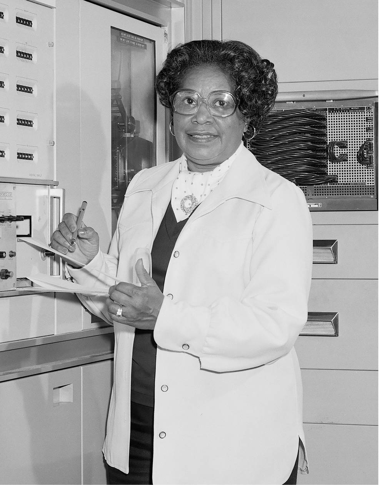

---
hide:
  - navigation
  - toc
---

FGA0315 · Qualidade de Software 1 · 2026/2 · Turma 01 · Grupo Mary Jackson

# Avaliação da qualidade do draw.io

Avaliação da segurança, da eficiência de desempenho e da manutenibilidade do draw.io, feita pela equipe Mary Jackson na disciplina Qualidade de Software 1 (FGA0315, UnB, 2026/2).

[Ver documentação](fase-1/index.md){ .md-button .md-button--primary }
[Artigo (PDF)](artigo/artigo-e1.pdf){ .md-button target="_blank" rel="noopener" }
[Repositório](https://github.com/FCTE-Qualidade-de-Software-1/2026-2_T01_MARY_JACKSON){ .md-button }

Este trabalho contou com apoio de ferramentas de IA; a ilustração da logo foi gerada por IA. [Consulte a declaração de uso de IA](sobre/uso-de-ia.md).
{ .mj-transparencia }

<figure class="mj-retrato">
  
  <figcaption><strong>Mary Jackson</strong><a href="https://commons.wikimedia.org/wiki/File:Mary_Jackson.jpg" target="_blank" rel="noopener">Fotografia histórica: NASA on The Commons</a></figcaption>
</figure>

Avaliação

<a class="mj-item" href="fase-1/"><small>E1 · 26/10/2026 · Em revisão</small>Fase 1: Estabelecer os requisitos</a>
<a class="mj-item" href="fase-2/"><small>E1 · 26/10/2026 · Em andamento</small>Fase 2: Especificar a avaliação</a>
<a class="mj-item" href="fase-3/"><small>E2 · Não iniciada</small>Fase 3: Projetar a avaliação</a>
<a class="mj-item" href="fase-4/"><small>E2 · Não iniciada</small>Fase 4: Executar a avaliação</a>

Projeto

<a class="mj-item" href="gestao/"><small>PSM/CID</small>Gestão do projeto</a>
<a class="mj-item" href="gestao/planejamento/"><small>Sprints e horas estimadas</small>Planejamento</a>
<a class="mj-item" href="gestao/atas/"><small>Reuniões e decisões</small>Atas</a>
<a class="mj-item" href="sobre/uso-de-ia/"><small>Ferramentas e conferência</small>Declaração de uso de IA</a>

Repositório

<a class="mj-item" href="https://github.com/FCTE-Qualidade-de-Software-1/2026-2_T01_MARY_JACKSON" target="_blank" rel="noopener"><small>Código e documentos</small>GitHub</a>
<a class="mj-item" href="https://github.com/FCTE-Qualidade-de-Software-1/2026-2_T01_MARY_JACKSON/releases" target="_blank" rel="noopener"><small>Versões entregues</small>Releases</a>
<a class="mj-item" href="https://github.com/FCTE-Qualidade-de-Software-1/2026-2_T01_MARY_JACKSON/tree/main/dados" target="_blank" rel="noopener"><small>Coleta e consolidação</small>Dados da avaliação</a>

Projeto acadêmico independente em homenagem a Mary Jackson, sem vínculo ou endosso da NASA ou do draw.io. [Identidade visual e créditos](sobre/uso-de-ia.md#identidade-visual-e-creditos).
{ .mj-identidade-nota }
