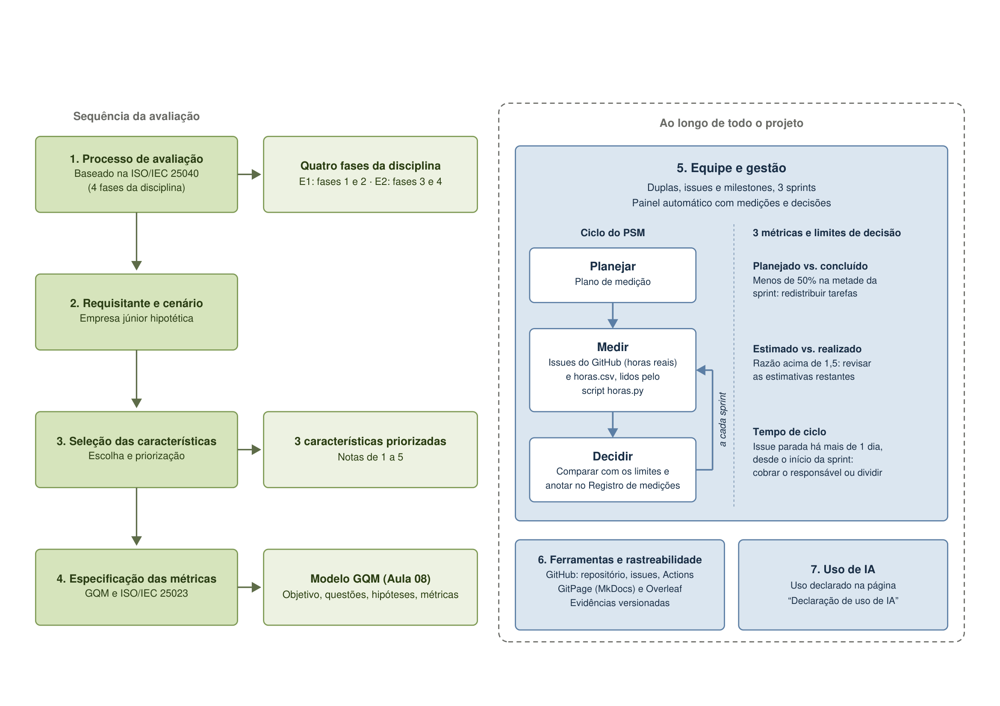

# Metodologia

A metodologia do projeto é guiada por um fluxo visual que se divide em duas partes: o fluxo sequencial da avaliação e os processos de gestão contínuos.

## Sequência da Avaliação

- **Processo de avaliação:** Baseado nas 4 fases da ISO/IEC 25040 (E1 cobre Fases 1 e 2; E2 cobre Fases 3 e 4).
- **Requisitante e cenário:** Avaliação aplicada ao contexto de uma empresa júnior hipotética.
- **Seleção das características:** Escolha e priorização de 3 características (Segurança, Eficiência, Manutenibilidade) com notas de 1 a 5.
- **Especificação das métricas:** Uso da ISO/IEC 25023 e do modelo GQM (Objetivo, Questões, Hipóteses, Métricas).

## Ao longo de todo o projeto

- **Equipe e Gestão (PSM/CID):** O projeto é organizado em duplas ao longo de 3 sprints, com painel automático gerando dados. O ciclo PSM funciona nas etapas de Medir (script horas.py em issues e horas.csv) e Decidir (Registro de medições). O replanejamento da Sprint 2 para a Sprint 3 seguiu três limites operacionais:
    - **Planejado vs. concluído:** < 50% na metade da sprint = redistribuir.
    - **Estimado vs. realizado:** Razão > 1,5 = revisar estimativas.
    - **Tempo de ciclo:** Issue parada > 3 dias = cobrar ou dividir.
- **Ferramentas:** GitHub (repositório, issues, Actions), GitPage (MkDocs) e Overleaf. Evidências são versionadas.
- **Uso de IA:** A documentação de apoio está declarada na página "Declaração de uso de IA".

_Figura 1. Metodologia do projeto. Fonte: elaboração da equipe._

## Onde ver cada etapa

- [Fase 1: Estabelecer os requisitos da avaliação](../fase-1/index.md)
- [Fase 2: Especificar a avaliação (GQM)](../fase-2/index.md)
- [Plano de medição (PSM/CID)](../gestao/plano-de-medicao.md)
- [Planejamento das sprints](../gestao/planejamento.md)